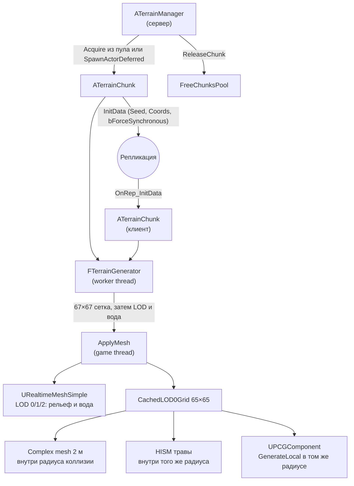
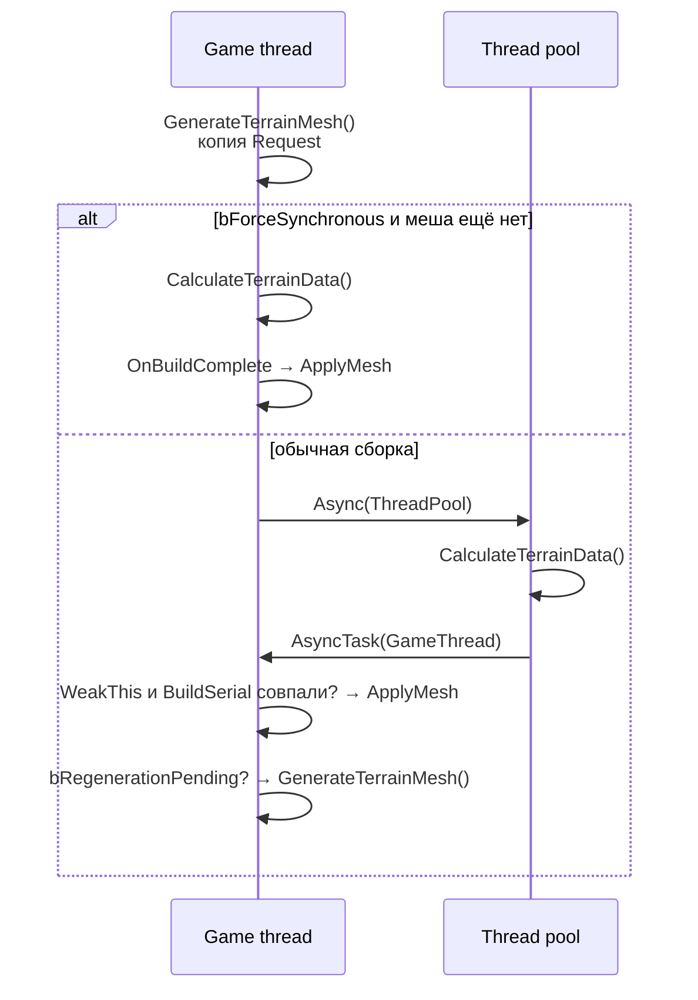

# MPSurv — технический документ

Состояние на 30.10.2026. Документ описывает код в `Source/MPSurv`. Единицы мира — сантиметры (1 м = 100 см).

## 1. Обзор

MPSurv — мультиплеерный survival-проект на Unreal Engine 5.8 (C++). Основная реализованная подсистема — бесконечный процедурный ландшафт:

- мир делится на квадратные чанки 64 × 64 м; сервер спавнит их и складывает лишние в пул, а не уничтожает;
- рельеф строится детерминированно из `Seed` и координат чанка, поэтому по сети реплицируются только эти данные, а не геометрия;
- острова и океаны задаёт шум континентальности, биомы суши — сетка Вороного с кольцами и широтными полосами;
- одна сборка считает высоту один раз на сетке 67 × 67 (вершины LOD 0 плюс бордюр в одну клетку). Визуальные LOD, вода, коллизия и трава только читают эту сетку;
- на машине, которая рисует, все три визуальных LOD и вода заливаются в `URealtimeMeshComponent` один раз на `InitData`. Дальше LOD выбирает рендерер по `ScreenSize`. Вход и выход из радиуса коллизии секции не пересобирают;
- коллизия — отдельный complex mesh с шагом 2 м, а не секция визуального меша. Трава и PCG живут в том же радиусе, что и коллизия.

Кроме ландшафта есть базовый персонаж от третьего лица на Enhanced Input и сэмплер PCG, который читает кэш сетки LOD 0.

## 2. Стек и конфигурация

| Параметр | Значение |
|---|---|
| Движок | Unreal Engine 5.8 (`EngineAssociation: 5.8`) |
| Модуль | `MPSurv` (Runtime) |
| Зависимости модуля | Core, CoreUObject, Engine, InputCore, EnhancedInput, RealtimeMeshComponent, PCG. Приватно — RHI |
| Плагины геймплея | RealtimeMeshComponent, PCG |
| Плагины редактора | ModelingToolsEditorMode, ModelContextProtocol, AllToolsets, NiagaraToolsets, PhysicsToolsets, EditorToolset, GASToolsets, Terminal |
| Рендер | DX12 SM6, Substrate. Distance Fields выключены (`r.GenerateMeshDistanceFields=False`), аппаратный ray tracing выключен (`r.RayTracing=False`), GPU Scene не резервирует буферы (`r.GPUScene.UseReservedResources=0`). Глобальное освещение выключено (`r.DynamicGlobalIlluminationMethod=0`), отражения — screen space (`r.ReflectionMethod=2`), Virtual Shadow Maps выключены (`r.Shadow.Virtual.Enable=0`), статическое освещение выключено |
| Объёмные облака и туман | `r.VolumetricCloud.ViewRaySampleCountMax=64`, `ShadowMap.MaxResolution=256`, `ReflectionRaySampleCountMax=0`, `HighQualityAerialPerspective=0`, `StepSize=2`. Туман: `r.VolumetricFog.GridPixelSize=16`, `GridSizeZ=64`. Motion blur и depth of field выключены (`r.MotionBlurQuality=0`, `r.DepthOfFieldQuality=0`) |
| Частота кадров | `bSmoothFrameRate=True`, `SmoothedFrameRateRange` от 22 до 60 FPS (верхняя граница Exclusive). В фоне действует `bUseBackgroundFrameRateLimit` |
| Карта по умолчанию | `/Game/MPS/Levels/TestTerrain.TestTerrain` |

Стандарты кода: Epic Coding Standard, типы UE (`TArray`, `FString`, `FVector`…) вместо `std::`. Единственное исключение — `std::atomic<bool>` для флага фоновой сборки. Воркер не обращается к UObject.

Чанк ландшафта пишет динамическую тень с LOD 0 и LOD 1. LOD 2 и вода тень не отбрасывают. Distance field и навигацию чанк не двигает. Статического освещения в проекте нет, поэтому тень идёт только динамическим проходом.

## 3. Структура исходников

```
Source/MPSurv/
├── MPSurv.Build.cs
├── Public/
│   ├── MPSurv.h
│   ├── TerrainChunk.h          — чанк, настройки генерации, биомы, LOD
│   ├── TerrainManager.h        — спавн, пул, стриминг
│   ├── WorldGenSettings.h      — общий Primary Data Asset мира
│   ├── BiomeDataAsset.h        — Primary Data Asset одного биома и его трава
│   ├── PCGProceduralMeshSampler.h
│   ├── BaseCharacter.h
│   └── PlayerCharacter.h
└── Private/
    ├── MPSurv.cpp              — регистрация аксессора $Normal для точек PCG
    ├── TerrainChunk.cpp        — генерация, меш, коллизия, трава
    ├── TerrainManager.cpp
    ├── WorldGenSettings.cpp
    ├── BiomeDataAsset.cpp
    ├── PCGProceduralMeshSampler.cpp
    ├── BaseCharacter.cpp
    └── PlayerCharacter.cpp
```

Математика рельефа — класс `FTerrainGenerator` в `TerrainChunk.cpp`. Он наследует `FTerrainGenerationSettings` и хранит только копии чисел.

## 4. Архитектура



Основные типы:

| Тип | Назначение |
|---|---|
| `ATerrainManager` | Сетка чанков на сервере: режимы спавна, очередь, стриминг, пул, радиус коллизии |
| `ATerrainChunk` | Реплицируемый актёр-чанк: сборка, секции Realtime Mesh, коллизия, трава, PCG |
| `FTerrainGenerator` | Математика генерации. Не обращается к UObject |
| `FTerrainGenerationSettings` | POD всех чисел генерации. Игровой поток заполняет его из ассетов перед каждой сборкой |
| `UWorldGenSettings` | Primary Data Asset общей формы мира |
| `UBiomeDataAsset` | Primary Data Asset одного биома: его форма и `GrassRules`. На каждый ID свой наследник |
| `FChunkInitData` | Реплицируемые данные: `Seed`, `Coords`, `bForceSynchronous` |
| `FTerrainBuildRequest` / `FTerrainBuildResult` | Что собрать и потоки всех визуальных LOD, воды, кэш сетки и инстансы травы |
| `FTerrainGridSample` | Один узел полной детализации: высота, нормаль, тангенс, цвет пары биомов, строгий ID |
| `FRingZoneSettings` / `FBiomeWeight` | Кольцо биомов: внешний радиус и взвешенный набор биомов |
| `UPCGProceduralMeshSamplerSettings` | Нода PCG `PCG_ProceduralMeshSampler`. Читает `CachedLOD0Grid` |
| `EBiomeType` | Ocean=0, Plains=1, Forest=2, Swamp=3, Plateau=4, Mountains=5, Desert=6, Oasis=7, Tundra=8, Jungle=9, Foothills=10 |

Оазис, тундра, джунгли и предгорья не разыгрываются как обычная ячейка Вороного внутри кольца. Оазис пишется внутри пустыни, предгорья — на низкой горной поверхности, тундра и джунгли — широтными полосами поверх колец.

## 5. Сетка и система координат

| Константа | Значение | Смысл |
|---|---|---|
| `ChunkWorldSize` | 6400 см | Сторона чанка, 64 м |
| `CellSize` | 100 см | Шаг вершин на LOD 0, 1 м |
| `QuadsPerSide` | 64 | `ChunkWorldSize / CellSize` |
| `NumLODs` | 3 | LOD 0: 64×64 квада (1 м), LOD 1: 32×32 (2 м), LOD 2: 16×16 (4 м) |

- Актёр чанка ставится в `Coords * ChunkWorldSize`, геометрия строится в его локальном пространстве.
- Два `static_assert` гарантируют, что `CellSize` делит `ChunkWorldSize` нацело, а `QuadsPerSide` делится на прореживание каждого LOD.
- Все LOD читают одну и ту же поверхность полной детализации. Грубый LOD берёт каждый второй или каждый четвёртый узел и высоту заново не считает.

## 6. Процедурная генерация

Сборка одного чанка, `ATerrainChunk::CalculateTerrainData`:

1. `FTerrainGenerator` копирует POD настроек и `InitData`. В конструкторе один раз считается `StartIslandLift`.
2. `CacheChunkLakes` собирает горные озёра, чья долина достаёт до чанка вместе с бордюром.
3. `CacheSurfaceGrid` один раз вызывает `ComputeHeight` на сетке `(QuadsPerSide + 3)²` = 67 × 67. Бордюр в одну клетку нужен центральным разностям нормалей.
4. Внутренние 65 × 65 узлов, без бордюра, копируются в `CachedLOD0Grid`.
5. Dedicated-сервер на этом останавливается: визуальных LOD, воды и травы нет.
6. Клиент для каждого LOD вызывает `BuildTerrainBuffers` (с юбками) и `BuildWaterBuffers`. Оба только читают уже посчитанную сетку.
7. Если в запросе есть правила травы, `BuildGrassTransforms` раскладывает инстансы по `CachedLOD0Grid`.

`ComputeHeight` — единственная функция итоговой высоты. Порядок внутри неё фиксирован и описан ниже.

### 6.1. Сид

`GetSeedOffsets` превращает `Seed` в два смещения `SeedLow` и `SeedHigh`: младшие 16 бит и следующие 16 бит, каждое по модулю 256. У `FMath::PerlinNoise2D` период 256, поэтому шум получается тот же, а малые смещения сохраняют точность float в дробной части координаты.

`Seed == 0` для чанка означает «не инициализирован»: `GenerateTerrainMesh` геометрию не строит. У менеджера `WorldSeed` по умолчанию 1337.

### 6.2. Континентальность: океан или суша

`SampleContinentNoise` складывает три слоя Perlin и нормализует сумму в [0, 1]:

| Слой | Вес | Частота |
|---|---|---|
| Континенты | 0.72 | `MacroFrequency` (0.000012) |
| Заливы и полуострова | 0.20 | ×2.3, домен повёрнут на 35° |
| Бухты | до 0.08 | ×5.1, вес гаснет при `Continents` от 0 до 0.45 |

Сумма делится на 0.82, потому что сложенные октавы почти не достигают краёв одной октавы. Иначе глубокий океан и высокие пики были бы недостижимы.

`SampleContinentalness` затем:

1. прибавляет подъём стартового острова и зажимает результат в [0, 1];
2. пропускает маску через `ComputeStraitMacroCap`. Пролив только понижает маску.

Пороги после зажима: `OceanThreshold` не уже 0.01…0.98, `MountainThreshold` хотя бы на 0.01 выше него и не выше 0.99.

- `Macro < OceanThreshold` — океан. Дно — `Lerp(-OceanMaxDepth, 0, OceanAlpha ^ 0.7)`. Степень 0.7 даёт крутой свал в котловину и пологий шельф. Подводные холмы затухают к берегу и не пробивают Z = 0. Детальный шум океана свой, тоже гаснет к берегу.
- Между порогами работает пляжный пандус `SmoothStep(OceanThreshold, MountainThreshold, Macro)`. На него умножается высота любого сухопутного биома, включая болото вдали от его собственной логики: у воды все выходят из моря одинаково.

**Стартовый остров.** Сырой шум континентов приподнимается к центру мира аддитивно:

- `Bias = SmoothStep(0, 1, Clamp(1 - Dist / StartIslandRadius, 0, 1))`: 1 в начале координат, 0 на `StartIslandRadius` (2.5 км);
- `Macro = Clamp(Noise + StartIslandLift * Bias, 0, 1)`, после чего на маску накладываются проливы;
- `StartIslandLift = Max(StartIslandStrength, MountainLimit - Noise(0, 0))` считается один раз в конструкторе генератора. Обычно это `StartIslandStrength` (0.3), но если у сида в центре глубокое море, подъём увеличивается ровно настолько, чтобы начало координат было сушей на полной высоте.

Подъём не срезает шум и не меняет бросок биома. Береговая линия по-прежнему идёт по изолинии шума. Какой биом стоит в центре, решает кольцо и широтная полоса.

### 6.3. Биомы суши

Сайт ячейки Вороного и её метка считаются раздельно. Сайт стоит на сетке. Метка читается в точке, сдвинутой низкочастотным warp.

`GetBiomeSite`:

- шаг ячейки — `BiomeCellSize` (600 м), не меньше 1 км в формуле, если ассет задаст меньше;
- сайт сдвинут хешем ячейки и сида в пределы [0.15, 0.85] ячейки;
- сайт ячейки (0, 0) прибит к началу координат, поэтому спавн лежит в глубине ячейки, а не на шве.

`QueryBiomeSites` перебирает окно 5 × 5. Ближайший сайт не дальше 1.42 ячейки, второй — 1.6. Смешивание достаёт сайты не дальше `BlendWidth` за ближайшим, и все они попадают в это окно. `DistanceToEdge = Dist2 - Dist1`: 0 на границе ячеек, растёт к центру.

`DetermineBiomeForCell` вешает метку. Warp частоты 0.000004 и амплитуды `BiomeWarpAmplitude` (1.2 км) сдвигает центр ячейки, сам сайт не двигает. По искажённой точке:

1. `Y > TundraLatitude` (5 км) — тундра.
2. `Y < DesertLatitude` (−4 км) — южная полоса. Меридиан джунглей шумит на ±1 км (частота 0.00003). К востоку от `JungleLongitude` — джунгли, к западу пустыня.
3. Иначе самое тесное кольцо, чей `MaxRadius` покрывает расстояние от начала координат. Точка дальше всех колец — луга. Пустое кольцо тоже даёт луга.

Кольца по умолчанию (`FRingZoneSettings::MakeDefaults`), от центра наружу:

| Внешний радиус | Биомы и веса |
|---|---|
| 2 км | Луга, вес 1 |
| 4 км | Лес 1, луга 0.25 |
| 6 км | Горы 1, лес 1 |
| 1000 км | Болото 1, плато 1 |

Внутри кольца один Perlin частоты 0.00004, приведённый к [0, 1], режет суммарный вес на доли. Порядок записей в массиве кольца задаёт, какой кусок шума кому достаётся. Порядок колец в ассете не важен: берётся наименьший подходящий `MaxRadius`. Оазис и предгорья в этот бросок не входят.

Пустынных дисков, `CenterPlainsRadius` и `BiomeFalloffRadius` в коде нет.

### 6.4. Смешивание высот

Основная ячейка входит с весом 1 и считается на своей глубине `Interior`. Сосед входит с весом `1 - SmoothStep(0, BlendWidth, d_i - d1)` и считается при `Interior = 0`. `BlendWidth = 0.15 · BiomeCellSize` (90 м). `Interior = clamp(DistanceToEdge / (0.5 · BiomeCellSize), 0, 1)` и ещё проходит через `SmoothStep` внутри формы биома.

Берутся все соседи в полосе смешивания, не только второй ближайший. Иначе в точке, где второй и третий сайт меняются местами, высота прыгала бы.

**Болото смешивается отдельно.** Его доля `SwampShare` считается той же формулой, но с шириной `clamp(SwampBlendWidth, 100 см, BlendWidth)` — по умолчанию 30 м. Остальные биомы смешиваются без болота, итог — `Lerp(Остальные, ComputeSwamp, SwampShare)`. Детальный шум в доле болота гасится.

На границе ячейки луга, лес, тундра, джунгли, горы и плато сходятся к `LandEdgeZ` = 2 м (у гор и плато на самой кромке ещё остаются базовые холмы). Пустыня сходится к `DesertBaseHeight` (5 м), а не к 2 м. Болото к общей кромке не притягивается: в него ведёт узкий берег.

### 6.5. Высота по биомам

| Биом | Форма | Примерный диапазон |
|---|---|---|
| Plains | `LandEdgeZ` + плавный Interior × (подъём 3 м + холмы `SampleHills`) | около 2–9 м в глубине |
| Forest | `LandEdgeZ` + Interior × (подъём 5 м + холмы только вверх). Две октавы, вторая повёрнута на 50°, компенсация диапазона 0.8. `ForestHillsHeight` — перепад от ложбины до вершины | до ~21 м |
| Tundra | Та же форма, что у лугов, со своими `TundraHills*` | как у лугов при дефолтах |
| Jungle | Та же форма, что у леса, со своими `JungleHills*` | как у леса при дефолтах |
| Swamp | `SwampBaseHeight + Perlin · SwampPuddleDepth`. Ниже 0 — лужи морской воды. Детального шума нет | от −0.6 до +1 м |
| Plateau | Уступ `SmoothStep` по `DistanceToEdge` от 20 м до 90 м, затем стол высотой `PlateauHeight`. Каньон врезается на 88 % этой высоты. Ступеней на стене нет: на сетке 1 м они становились пилой | до ~72 м |
| Mountains | Анизотропный гребень. Масса растёт с континентальностью и Interior и на границе ячейки сходит к `LandEdgeZ` плюс холмы предгорий | до `MountainMaxHeight` (400 м) |
| Foothills | Та же функция, что у гор. Строгий ID и детальный шум переключаются после озёр, если итоговая база ниже `FoothillsMaxHeight` (80 м) | нижняя часть гор |
| Desert | `DesertBaseHeight + Interior × (1 - abs(Perlin))² × DesertDuneAmplitude`. Степень 2 расширяет ложбины и заостряет гребни. К границе барханы сходят к базе 5 м | 5–30 м |
| Ocean | Шельф из раздела 6.2. В таблицу суши не входит | до −45 м |

`SampleHills` — две октавы в [−1, 1]: широкий вал весом 0.70 и гребень ×2.15, повёрнутый на 60°, весом 0.30, делённые на 0.85.

**Горы.** Гребень повёрнут на 45° и вдоль хребта растянут в 0.45 раза, затем `1 - abs(Perlin)` в степени 1.7. Отроги — тот же приём на частоте ×2.2, скалы — на ×4.7. Скелет аддитивный: `BaseMass` от `MountainAlpha ^ 1.2` даёт 30 % массы, хребет и гармоники — 70 %. `MountainAlpha` зажимает `(Macro - OceanThreshold) / (0.88 - OceanThreshold)` и умножает на Interior. Потолок 0.88 стоит потому, что нормализованный Perlin редко доходит до 1, и без него пик не достигал бы `MountainMaxHeight`. У границы ячейки `MountainAlpha = 0`, остаётся база `LandEdgeZ` и холмы, которые гаснут вверх по склону.

**Плато и каньон.** `SampleCanyonWall`: domain warp до 45 м вбок (частота 0.000035), затем `abs(Perlin)` плюс шум кромки ±0.035. Пол каньона — ниже `CanyonFloorWidth`, стена — `SmoothStep` до `CanyonWidth`, дальше нетронутый стол. `Steepness = 4·t·(1-t)` гасит детальный шум на самой крутой части стены, и только после того, как уступ уже начался. Холмы на столе режутся на 85 %, на дне каньона — на 65 %.

**Оазисы.** Кандидаты лежат на сетке `OasisGridSize` (300 м), по одному на ячейку. Центр — `FRand()` по обеим осям от хеша ячейки и сида (`0x5BD1E995`). Шанс — следующий `FRand()` против `OasisSpawnChance` (30 %). Радиус зажат в размер сетки, поэтому кандидат, покрывающий точку, лежит в окне 3 × 3. При перекрытии берётся ближайший: высота зависит только от расстояния, и на равной дистанции шов не возникает.

Кандидат остаётся, если центр в ячейке пустыни и `DistanceToEdge` не меньше `BlendWidth + 2 · OasisRadius`. С таким запасом вся чаша лежит в чистой пустыне, без веса соседа. И если барханы в центре не выше `OasisMaxDuneHeight` (10 м) над базой.

Профиль по расстоянию `d` от центра, `WaterRadius` не больше 80 % радиуса:

- `d < OasisWaterRadius` (15 м): чаша `−1.5 · (1 - (d/R)²)` м, её заполняет морская вода;
- первая половина полосы берега (`OasisBankShare` = 0.5): склон от уреза до `DesertBaseHeight`, круче у воды;
- вторая половина до `OasisRadius` (50 м): барханы выравниваются до `DesertBaseHeight`.

Детальный шум к центру оазиса гаснет. Вся площадь в радиусе, включая воду, получает строгий ID `Oasis`.

### 6.6. Реки: морские проливы

Реки — длинные извилистые морские проливы на уровне моря. Они понижают маску континентальности, а не высоту отдельной формулой. Поэтому пляж, масса гор и проверка озёр видят их как море. Ручьёв и притоков нет. `RiverFrequency = 0` или `RiverWidth = 0` проливы выключает.

- **Линия** — нулевая изолиния Perlin. Два warp складываются, а не вкладываются: изгиб амплитудой 160 м на частоте 0.0000125 и меандр 40 м на частоте 0.00004. Оба `amplitude · frequency` заметно меньше 1, поэтому пространство не складывается в петли.
- **Ширина.** Расстояние до середины — `|n| / |∇n|`, шаг градиента 100 см. Если `|n|` уже больше досягаемости при максимальном наклоне шума, градиент не считается. Ширина воды колеблется ×0.7–1.3 с длиной волны около 500 м. Плоское дно — внутренние 40 % полуширины, дальше дно поднимается к порогу океана, и за `RiverShoreWidth` (60 м) потолок доходит до `MountainThreshold`. Потолок только понижает маску.
- **Глубина.** Макро на середине подобрано так, чтобы профиль шельфа из раздела 6.2 дал `−RiverDepth` (10 м), но не глубже `OceanMaxDepth`. Строгий ID в проливе — `Ocean`.
- **Центр мира.** В радиусе `StraitFreeRadius` (300 м) сила пролива 0. За следующие 200 м она нарастает `SmoothStep`. Пролив у центра мелеет и заканчивается заливом.
- **Пустыни.** Сила умножается на `1 - доля пустыни` по тем же весам, что и смешивание высот. Пролив затухает в полосе смешивания и кончается заливом на краю пустынной ячейки.
- **Горы.** Если ближайшая ячейка — горы, сила 0. Если горы только вторые, сила гаснет по `DistanceToEdge` на `RiverMountainFadeWidth` (300 м) и на предгорье уже нулевая. Русло поднимается обратно в нетронутый рельеф и хребет не режет.

Запрос Вороного для пустыни и гор делается только у точек, которые уже лежат рядом с изолинией.

### 6.7. Горные озёра

Кандидаты: по одному на ячейку 400 × 400 м. Хеш ячейки и сида, без дополнительной соли.

1. `FRand() > 0.35` — ячейка пустая.
2. Центр в [0.25, 0.75] ячейки.
3. Следующий `FRand() ≥ 0.5` — «кальдера», радиус 55–75 м. Иначе радиус 28–42 м. Имя в данных — только размер; форма берётся следующим броском.
4. `FRand()`, чей результат не читается. Он сдвигает поток. Убирать его нельзя: тип озера и углы от следующих бросков зависят.
5. Тип: `FRand() ≥ 0.5` — тектонический разлом, иначе ледниковый кар. Разлом — эллипс, отношение осей 2.0–2.6, повёрнут на 45° вдоль хребта. Кар — подкова: задняя стена в 1.35 раза ближе среднего радиуса, открытый фронт в 0.65 раза, угол равномерный на [0, 2π).

Берег дополнительно коробит Perlin: частота 0.00015, амплитуда 18 м. Морфологическая дистанция равна `Radius` на урезе.

`ValidateLake` оставляет кандидата, если:

- в центре пандус суши уже ненулевой;
- ближайшая ячейка — горы и Interior ≥ 0.3, то есть соседи в центр не смешиваются;
- восемь точек за некоробитым берегом (отступ 12 м) всё ещё в горах, и самая низкая из них выше `LandEdgeZ` хотя бы на 5 м.

Уровень воды — высота гор в центре минус 12 м. Глубина чаши — 8 м. Чаша под водой: `WaterZ - BedDepth · (1 - t²)`. Дальше до 2.2 радиуса — дно долины, которое поднимается на 0.5–3 м над водой и на 65 % ещё помнит гору. До 3.3 радиуса — переход обратно в сырую поверхность. На внешнем радиусе формула совпадает с горой, поэтому озеро, которое вошло или вышло из списка, шва не оставляет.

Перекрывающиеся долины складываются в одном глобальном порядке `(CellY, CellX)`. Вклад умножается на вес гор, поэтому долина, вышедшая из горной ячейки, встречается с соседом гладко. Детальный шум над водой и дном долины падает до 0.08 и возвращается к 1 на внешнем радиусе.

`CacheChunkLakes` один раз за сборку берёт озёра, чей охват пересекает чанк с бордюром. Дальний охват — переходный радиус самой большой чаши через открытый фронт кара плюс warp берега.

Вода озера ставится на квад, только если центр квада внутри радиуса плюс перекрытие 2 м и дно не глубже чаши больше чем на 6 м. Иначе квад висит над обрывом и воду не получает.

### 6.8. Детальный шум, строгий ID и цвет вершины

Детальный шум сэмплируется по биомам тем же взвешиванием, что и высота, и прибавляется в конце. Болото и оазис в `SampleBiomeDetail` дают 0. Океан считает свой шум в ветке моря. Амплитуды по умолчанию: луга, лес, тундра, джунгли, плато и предгорья ±2 м, горы ±8 м, пустыня ±0.5 м, океан в глубине ±0.2 м.

Шум гасится в пределах 2 м от уровня моря (`ShoreDetailFadeHeight`), чтобы урез не распадался на ступени сетки. У озёр и к центру оазиса он гасится отдельно, как описано выше. `GetTerrainDeltaHeight` — заготовка под правки в рантайме и возвращает 0. Сетка чанка всегда считается при `DetailScale = 1`. Грубый LOD эту функцию второй раз не вызывает.

**Строгий ID**, после озёр и пандуса, в таком порядке:

1. точка внутри оазиса — `Oasis`, даже если чаша ниже моря;
2. маска океана или затопленный берег (`CoastWeight > 0` и высота < 0) — `Ocean`. Внутренние лужи болота, уже вне этой береговой полосы, остаются `Swamp`. `CoastWeight` равен 1 на урезе и спадает до 0 на 18 % пляжного пандуса;
3. основная ячейка — горы и база ниже `FoothillsMaxHeight` — `Foothills`, детальный шум заменяется на шум предгорий;
4. иначе биом основной ячейки.

**Цвет вершины** хранит пару, а не один ID. Из положительных весов берутся два самых тяжёлых. `PackBiomeVertexColor` пишет в R меньший ID, в G больший, в B вес G (0–255), A = 255. Более тяжёлый биом — G при B ≥ 128, иначе R. Если второй вес обнулился, вторым ID остаётся биом второго ближайшего сайта, а B говорит, что узел целиком принадлежит первому: соседний узел на границе всё ещё смотрит на ту же пару.

Море, оазис и предгорья не являются весом Вороного. Когда их строгий ID отличается от лидера пары, они становятся более тяжёлым биомом и оставляют прежнего лидера вторым. На сухом берегу, где в паре ещё нет океана, океан дописывается вторым с весом лидера, умноженным на `CoastWeight`, чтобы квад через урез нёс `Ocean` в одном канале, а менялся только B.

Если в весах три и больше биома, третий отбрасывается и B прибивается к 0 или 255. Иначе растеризация смешала бы три ID через один B.

`HarmonizeBiomePairColors` проходит по сетке до сборки меша. Чистый узел (`R == G`), у которого сосед уже несёт пару с тем же доминантным ID, принимает эту пару и прибивает B. `SplitInconsistentBiomeTriangles` затем даёт каждому треугольнику одну пару. Угол, который с парой не согласен, пишется отдельной копией вершины и с соседом другой пары не делится. Общая вершина сетки остаётся общей только там, где все треугольники согласны в R и G. GPU интерполирует вес, а не номера биомов.

### 6.9. Трава

Правила лежат на `UBiomeDataAsset::GrassRules`. Игровой поток переписывает `BiomeId` из типа ассета, поэтому меш с ассета болота не может сесть как лес. В запрос воркера копируются только числа. Указатель на меш остаётся на игровом потоке. Пустой список, океан и запись без меша в запрос не попадают. Первая клиентская сборка с пустым списком всё равно помечает кэш готовым: для этих координат травы нет.

Воркер строит инстансы сеткой с шагом `SpawnStep`, не по вершинам ландшафта. Центр клетки дёргается внутри клетки хешем мировых координат, сида и ID биома. Высота, нормаль и строгий биом читаются билинейно из 65 × 65. Строгий ID — у узла с наибольшим билинейным весом. При равном весе побеждает меньший ID. Это не то же самое, что `BiomeId` для PCG: PCG берёт доминанту цвета каждой вершины, трава — строгий ID доминирующего узла.

Точка остаётся, если высота в [`MinHeight`, `MaxHeight`], уклон не круче `MinUpDot`, нормализованный Perlin не ниже `GrassDensityThreshold` и выпал `SpawnChance`. Частота шума умножается на координату в сантиметрах; 0.005 — пятно примерно раз в 2 м. Ноль частоты или порога проверку шума выключает. Масштаб — `ScaleMin`…`ScaleMax`. Поворот только по рысканию. В custom data канал 0 — фаза ветра, канал 1 зарезервирован под примятие и пишется нулём.

Кэш трансформов живёт на чанке всё время этих координат. HISM создаётся, когда пешка входит в радиус включения, и только для биома, у которого есть хотя бы один инстанс. Выход за радиус выключения делает `ClearInstances`, прячет компонент и снимает его с регистрации. Следующий вход заполняет тот же HISM. `RemoveGrassInRadius` — заглушка.

Каждый HISM создаётся `Stationary`, без коллизии, тени, distance field и навигации. Дистанция отсечения инстансов по умолчанию: начало 80 м, конец 120 м.

## 7. Меш

### 7.1. Realtime Mesh

Корень чанка — `URealtimeMeshComponent`, данные — `URealtimeMeshSimple`. Два слота материала: 0 — рельеф (`TerrainMaterial`), 1 — вода (`WaterMaterial`). На каждом визуальном LOD две группы секций, `Terrain` и `Water`. Группа с пустым потоком позиций не создаётся, поэтому сухой LOD воды не имеет. Тип отрисовки — `ERealtimeMeshSectionDrawType::Static`.

`ScreenSize`: LOD 0 при 1, LOD 1 при `LOD1ScreenSize` (0.45), LOD 2 при `LOD2ScreenSize` (0.06). Значение последнего LOD — порог отсечения: чанк меньше этого на экране не рисуется. Это дальний край кольца стриминга.

Секции заливаются один раз на пару `Seed` + `Coords`. Повторный вход в радиус коллизии `CreateSectionGroup` не вызывает. Смена дистанции камеры секции не переключает: видимый LOD выбирает рендерер.

На dedicated-сервере визуальных секций нет. Пока чанк вне радиуса коллизии, сервер и сетку высот не считает. Первое включение коллизии строит только `CachedLOD0Grid`.

**Мобильность.** Корень создаётся `Movable`: пул переносит актёра через `SetActorLocation`, а `Stationary` с места не двигается. `PrepareChunkForTeleport` перед переносом снимает указатель меша и возвращает корень в `Movable`. Первая публикация ставит `Stationary` до `SetRealtimeMesh`, поэтому первый прокси уже стационарный. `SettleChunkMobility` повторяет это после готовности секций и заново ставит `Stationary` каждому живому HISM: перевод родителя в `Movable` утаскивает детей и сам их не возвращает.

**Тени и прочее.** `bCastDynamicShadow = true`, `bCastStaticShadow = true`, `bAffectDistanceFieldLighting = false`, `SetCanEverAffectNavigation(false)`. Секция рельефа на LOD 0 и LOD 1 отбрасывает тень, LOD 2 и вода — нет. Прокси Realtime Mesh копирует флаги компонента и ещё смотрит `bCastsShadow` секции. Профиль коллизии до готовности тела — `BlockAll`, но `CollisionEnabled` начинается с `NoCollision`.

### 7.2. Построение сетки (`BuildTerrainBuffers`)

1. LOD 0 берёт каждый внутренний узел, LOD 1 — каждый второй, LOD 2 — каждый четвёртый. Общая вершина на стыке разной плотности — один и тот же сэмпл.
2. Триангуляция шахматная (`SplitQuadCheckerboard`): диагональ квада чередуется по `(X + Y)`. Одинаковая диагональ на склоне, растущем по обеим осям, выстраивалась в гребень. Вода эту схему не использует: все её квады режутся одной диагональю.
3. Нормаль — центральная разность на ±`CellSize`, масштаб наклона `NormalStrength`, затем единичная длина. Нулевой вектор заменяется на вверх. Тангенс — проекция +X на плоскость нормали, при вырождении +Y. UV рельефа в [0, 1] по чанку.
4. Цвет — пара биомов из раздела 6.8, уже выровненная по сетке. Треугольники с разными парами получают копии углов.
5. Юбки (`AppendSkirts`): край опущен на `SkirtDepth` (10 м). Закрывают щели между соседями разного LOD. В коллизию юбки не входят.

### 7.3. Вода (`BuildWaterStreams`)

`BuildTerrainStreams` и `BuildWaterStreams` пишут вершины сразу в `FRealtimeMeshStreamSet` через `TRealtimeMeshBuilderLocal`. Промежуточного `FTerrainMeshBuffers` нет.

На каждом визуальном LOD своя вода по уже прореженной сетке высот этого LOD.

- Квад получает воду озера, если над его центром есть озеро с валидным дном и центр внутри радиуса плюс 2 м.
- Иначе квад получает море, если хоть один угол не выше `0 + 1.5 м`.
- У каждого уровня воды своя карта вершин. Море и озеро не сшиваются через разные высоты.
- UV в мировых метрах (`× 0.01`), чтобы тайлинг волн шёл через границу чанка.
- Цвет RGB — маска затухания волн: 0 у берега, 255 на глубине от 30 см. Нормаль воды смотрит вверх.

### 7.4. Объём на один чанк

Высота считается один раз: 67² = 4489 сэмплов. Ниже — то, что из них нарезается.

| LOD | Вершин (без юбок) | Треугольников | Шаг |
|---|---|---|---|
| 0 | 65² = 4225 (+256 юбки) | 8192 (+512) | 1 м |
| 1 | 33² = 1089 (+128) | 2048 (+256) | 2 м |
| 2 | 17² = 289 (+64) | 512 (+128) | 4 м |

Копии углов под разные пары биомов к этому числу добавляются и заранее не ограничены. Коллизия — ещё 33 × 33 вершины и 2048 треугольников, без юбок. Сваренное тело остаётся на чанке, пока актёр в кольце. В пуле оно уничтожается.

### 7.5. Коллизия

`BuildCollisionData` берёт каждый второй узел `CachedLOD0Grid`: 32 × 32 квада, 2048 треугольников, та же шахматная диагональ, имя меша `Terrain`. Это complex mesh, не выпуклые оболочки.

`bUseAsyncCook = true`, `bUseComplexAsSimpleCollision = true`. Тело готовится один раз при первом входе в радиус. Колбэк готовки всегда уходит в `AsyncTask` на игровой поток: колбэк приходит под read lock меша, а `SetMobility` берёт write lock. Пока серийник колбэка совпадает, компонент получает `BlockAll` и `ECC_WorldStatic`. `SetCollisionEnabled` сам обновляет физическое состояние. Выход из радиуса только ставит `NoCollision` и оставляет сваренное тело. `BodySetup` и complex mesh уничтожаются в `ResetChunkState`, когда актёр возвращается в пул. Повторный вход в радиус включает уже готовое тело и не варит его заново.

Сервер выставляет радиус через `SetCollisionEnabled`, когда пешка переходит в другую клетку чанка. Клиент на той же смене клетки вызывает `RefreshCollisionState`. Принудительный LOD 0 коллизию не включает.

## 8. Многопоточность



- `CalculateTerrainData` статическая и не использует `this`. В фоне только `FMath`, `FRandomStream`, хеши и скопированный POD.
- `std::atomic<bool> bIsGenerating` не пускает вторую сборку. Запрос во время сборки ставит `bRegenerationPending`.
- `BuildSerial` растёт при смене `InitData`. Результат для старых данных отбрасывается. Если актёр уже уничтожен, `WeakThis` пуст.
- Повторный вызов после первой сборки на клиенте до воркера не доходит: он вызывает `UpdateLocalProximity`. Dedicated-сервер запускает вторую сборку только чтобы впервые получить сетку высот под коллизию.
- Первая сборка синхронна только при `bForceSynchronous` и ещё не построенном меше. Дальше всегда асинхронно. Флаг реплицируется.

Кто получает синхронную первую сборку:

| Где | Условие |
|---|---|
| `SpawnChunksInRadius` | Все чанки предспавна вокруг `PlayerStart` и уже существующих пешек |
| `Tick` (`StaticDebugGrid`) | Только первый чанк сессии, центральный |
| Остальные | Асинхронно, включая спавны стриминга вне `PreSpawnRadius` |

## 9. Сеть и радиус коллизии

- `ATerrainChunk` и `ATerrainManager` реплицируются, движение актёров не реплицируется.
- Реплицируется только `InitData`.
- `NetCullDistanceSquared = (16 · ChunkWorldSize)²`, около 1 км.
- Визуальный LOD локальный и считается на рендер-потоке по `ScreenSize`. Отдельного таймера на чанк нет.
- `ATerrainChunk` спит в сети: `NetDormancy = DORM_DormantAll`. `FlushNetDormancy` вызывается только когда authority меняет `InitData` — при инициализации клетки и при возврате в пул.
- **Коллизия на authority** — `bServerCollisionEnabled`. Менеджер выставляет его в радиусе 2 чанков (128 м) от любого игрока. Отладочная сетка коллизию не включает.
- **Коллизия** — радиус 2 чанка. **Трава и PCG** включаются на том же радиусе и выключаются на радиусе 3, чтобы шаг вдоль границы клетки не пересоздавал их. На выходе HISM очищается и снимается с регистрации, компонент остаётся на чанке. `GeneratePCG` и обновление травы идут очередью менеджера, не больше одного чанка за кадр.
- Менеджер на каждом тике сравнивает клетку пешки (`FIntPoint`) с прошлой. Пока пешка внутри того же квадрата 64 × 64 м, близость чанков не пересчитывается. Смена клетки обновляет коллизию сразу и ставит траву с PCG в очередь.
- Клиент ищет менеджер через владельца чанка и кэш, а не через `ActiveChunks`: карта живых чанков есть только на сервере. На клиенте опрос клетки идёт по актёрам чанков в мире.
- Dedicated-сервер траву и PCG не ставит в очередь. На смене клетки он только включает или выключает коллизию.

## 10. `ATerrainManager`

Работает только на authority. Режим задаёт `SpawnMode`.

### 10.1. Пул

`DespawnChunk` не уничтожает актёр. `ResetChunkState` увеличивает `BuildSerial`, прячет актёра, сбрасывает меш, траву и PCG и кладёт его в `FreeChunksPool`. Реплицируемый `InitData` на время пула обнуляется, чтобы повторное использование тех же координат всё равно вызвало `OnRep`. `AcquireChunk` достаёт актёра, переводит в `Movable`, ставит на новые координаты. Новая первая сетка после переноса снова заливает все LOD. Пул не уменьшается, пока идёт сессия.

### 10.2. `StaticDebugGrid`

Осмотр ландшафта в Simulate, в геймплее не используется.

- `SpawnInitialGrid` кладёт в очередь квадрат `[-GridRadius, GridRadius]²`. При радиусе 15 это 31 × 31 = 961 чанк. Очередь отдаёт ближние чанки первыми. Выше 1024 чанков остаются только ближайшие к началу координат.
- `Tick` спавнит `ChunksPerFrame` чанков за кадр, пока очередь не пуста. Сетки строятся на воркерах. Коллизии нет. Первый, центральный чанк строится синхронно. Остальные чанки отладочной сетки — нет.

### 10.3. `DynamicStreaming`

- **Старт:** синхронный предспавн радиусом `PreSpawnRadius` (2) вокруг каждого `PlayerStart` и уже существующих пешек, иначе вокруг начала координат. Затем таймер `StreamingUpdateInterval` (0.1 с).
- **`UpdateStreaming`:**
  1. Собирает позиции пешек. Без пешек ничего не делает и чанки не выгружает.
  2. Если кольцо уже собрано (`bStreamingRingSettled`) и все пешки остались в тех же клетках чанков, сканирование сетки пропускается. Следующий проход начинается, когда кто-то переходит в другую клетку.
  3. Возвращает в пул чанки дальше `StreamingRadius + DespawnMargin` (8 + 2) от всех игроков.
  4. Сортирует недостающие чанки по расстоянию до ближайшего игрока. Расстояние считается до ближайшей точки квадрата чанка.
  5. Спавнит до `MaxChunksPerUpdate` (1) за тик. Чанки в `PreSpawnRadius` идут вне этого бюджета и синхронно. Коллизию нового чанка задаёт спавн. Дальше её переключает смена клетки пешки, не этот таймер.
- `bLogStreaming` пишет изменения, `bDrawStreamingDebug` рисует круги загрузки и выгрузки.

`SpawnChunk` при новом актёре использует `SpawnActorDeferred`, выставляет коллизию до первой сборки и только потом `InitializeChunk` и `FinishSpawning`.

## 11. PCG

- `UPCGComponent` создаётся неактивным, `GenerationTrigger = GenerateOnDemand`.
- `GeneratePCG` ставится в очередь менеджера, пока чанк внутри радиуса включения и кэш 65 × 65 уже есть. За кадр из очереди выходит один чанк. Выход за радиус выключения вызывает `ReleasePCG`: `CleanupLocalImmediate` и `bActivated = false`. Следующий вход строит граф заново. Смена визуального LOD граф не трогает. Возврат в пул тоже его гасит.
- Граф в коде не назначается. Его задают в Blueprint-наследнике `ATerrainChunk`, класс указывают в `ChunkClass`.
- Нода `PCG_ProceduralMeshSampler` (`UPCGProceduralMeshSamplerSettings`) читает `GetCachedLOD0Grid`, по точке на узел. Штатному сэмплеру нужна запечённая коллизия, этому — нет. Юбки и копии углов в кэш не входят: кэш заполняется до нарезки треугольников. Нода выполняется только на игровом потоке и не кэшируется.
- Атрибут `BiomeId` — доминанта цвета узла (G при B ≥ 128, иначе R). Это не поле `StrictBiome`. Цвет точки хранит ту же пару в 0–1. `$Normal` — свойство точки `UMPSurvTerrainPointData`, не метаданные. Аксессор регистрируется в `FMPSurvModule`. Поворот точки по Z совпадает с нормалью вершины.

## 12. Персонаж

- `ABaseCharacter` — заготовка от `ACharacter`, логики нет, Tick включён.
- `APlayerCharacter` — камера от третьего лица на `USpringArmComponent` (300 см). Тело поворачивается по направлению движения.
  - Enhanced Input: `IA_Look` и `IA_Walk`. `DefaultMappingContext` добавляется в `NotifyControllerChanged`.
  - Ассеты ввода задаются в Blueprint-наследнике.

## 13. Параметры

### 13.1. Настройки генерации

Общая форма мира — `UWorldGenSettings`. Форма биома и трава — наследник `UBiomeDataAsset` на каждый ID, включая тундру, джунгли и предгорья. Менеджер держит мягкие ссылки, на игровом потоке загружает ассеты и копирует числа в `FTerrainGenerationSettings`. Воркер получает только копию. Пустая ссылка оставляет дефолт структуры.

**Общие** (`UWorldGenSettings`)

| Параметр | По умолчанию | Назначение |
|---|---|---|
| `NormalStrength` | 1.0 | Усиление уклона в нормалях |
| `SkirtDepth` | 1000 см | Глубина юбок |
| `MacroFrequency` | 0.000012 | Частота маски континентальности |
| `OceanThreshold` | 0.50 | Порог океана |
| `MountainThreshold` | 0.66 | Конец пляжного пандуса |
| `StartIslandRadius` | 250000 см | Радиус подъёма континентальности |
| `StartIslandStrength` | 0.3 | Подъём в центре |
| `StraitFreeRadius` | 30000 см | Радиус без проливов, плюс 200 м затухания |
| `BiomeCellSize` | 60000 см | Шаг ячеек Вороного |
| `BiomeWarpAmplitude` | 120000 см | Сдвиг точки, по которой выбирается метка биома |
| `RingZones` | 2 / 4 / 6 / 1000 км | Кольца из раздела 6.3 |
| `DesertLatitude` | −400000 см | Южнее — пустыня или джунгли |
| `TundraLatitude` | 500000 см | Севернее — тундра |
| `JungleLongitude` | 0 | На южной полосе восточнее — джунгли |
| `FoothillsMaxHeight` | 8000 см | Горная база ниже этого — предгорья |
| `OasisGridSize` | 30000 см | Шаг сетки оазисов |
| `RiverFrequency` | 0.000006 | Частота проливов |
| `RiverWidth` / `RiverShoreWidth` / `RiverDepth` | 4000 / 6000 / 1000 см | Вода, берег, глубина |

**По биомам**

| Биом | Параметры | По умолчанию |
|---|---|---|
| Ocean | `OceanMaxDepth`, холмы, деталь | 4500; 0.00009 / 800; 0.00025 / 20 |
| Plains | холмы, деталь | 0.00009 / 400; 0.00025 / 200 |
| Forest | `ForestHillsFrequency` / `ForestHillsHeight`, деталь | 0.0002 / 1400; 0.00025 / 200 |
| Swamp | база, лужи, `SwampBlendWidth` | 20; 0.001 / 80; 3000 |
| Plateau | высота, каньон, холмы, деталь | 7000; 0.000032 / 0.22 / 0.06; 0.00009 / 400; 0.00025 / 200 |
| Mountains | `MountainMaxHeight`, гребень, холмы, деталь | 40000; 0.000016; 0.00009 / 400; 0.00025 / 800 |
| Desert | барханы, база, деталь | 0.00005 / 2500; 500; 0.00025 / 50 |
| Oasis | шанс, радиусы, максимальная высота бархана | 0.3; 5000 / 1500; 1000 |
| Tundra | холмы, деталь | 0.00009 / 400; 0.00025 / 200 |
| Jungle | холмы, деталь | 0.0002 / 1400; 0.00025 / 200 |
| Foothills | только деталь; форма берётся у гор | 0.00025 / 200 |

**Трава** на записи `GrassRules` (дефолт записи, не обязательно заполненной на ассете)

| Параметр | По умолчанию |
|---|---|
| `SpawnStep` | 50 см |
| `SpawnChance` | 0.35 |
| `GrassNoiseFrequency` | 0.005 |
| `GrassDensityThreshold` | 0.4 |
| `MinHeight` / `MaxHeight` | 50 / 8000 см |
| `MinUpDot` | 0.8 |
| `ScaleMin` / `ScaleMax` | 0.85 / 1.25 |
| `CullDistanceStart` / `CullDistanceEnd` | 8000 / 12000 |

### 13.2. Чанк

| Параметр | По умолчанию |
|---|---|
| `LOD1ScreenSize` | 0.45 |
| `LOD2ScreenSize` | 0.06, порог, ниже которого чанк не рисуется |
| `TerrainMaterial`, `WaterMaterial` | Не заданы |

### 13.3. `ATerrainManager`

| Параметр | По умолчанию |
|---|---|
| `ChunkClass` | `ATerrainChunk` |
| `WorldSeed` | 1337 (0 = чанки без геометрии) |
| `SpawnMode` | `StaticDebugGrid` |
| `ChunksPerFrame` | 1 |
| `GridRadius` | 15 |
| `StreamingRadius` / `DespawnMargin` | 8 / 2 чанка |
| `StreamingUpdateInterval` | 0.1 с |
| `MaxChunksPerUpdate` | 1 |
| `CollisionRadiusInChunks` | 2 |
| `PreSpawnRadius` | 2 |

## 14. Детерминизм

- Случайность берётся из `Seed` и координат: `FRandomStream` от хеша для ячеек, оазисов и озёр, `FMath::PerlinNoise2D` со смещениями сида.
- Метка биома зависит от warp и от порядка весов в кольце. Один и тот же ассет колец даёт одну и ту же карту.
- Озёра перебираются в глобальном порядке `(CellY, CellX)`. Перекрывающиеся долины складываются одинаково при любом источнике запроса. Неиспользуемый `FRand()` в `MakeLakeCandidate` — часть этого потока.
- Высоты считаются в мировых координатах. Бордюр берёт поверхность соседа, поэтому стыки совпадают по высоте, нормали и паре биомов.
- Грубая сетка не пересчитывает шум. Она читает те же узлы, что и LOD 0, поэтому ребро LOD 2 совпадает с каждым четвёртым ребром LOD 0.

## 15. Известные ограничения

- **Срочный предспавн вне бюджета.** Чанки в `PreSpawnRadius` спавнятся все сразу, не по `MaxChunksPerUpdate`.
- **Детерминизм float между платформами.** Сервер и клиенты считают высоты независимо. Младшие биты float могут разойтись.
- **Асинхронная коллизия.** Обычные чанки стриминга получают тело через несколько кадров после спавна. При очень быстром движении игрок может обогнать готовку.
- **Коллизия реже визуальной сетки.** Тело берёт каждый второй узел LOD 0. Щели уже 2 м физика не повторяет.
- **`GetTerrainDeltaHeight` и `RemoveGrassInRadius`** — заглушки.
- **`ABaseCharacter`** — пустая заготовка с включённым Tick.
- **Подъём стартового острова** меняет континентальность и не меняет розыгрыш биома. Это описано у `StartIslandRadius`.
- **Старые поля ассета мира.** Пока `DA_WorldGenSettings` не пересохранён, в нём могут лежать удалённые из кода свойства. Код их не читает.

## 16. Настройка сцены

1. Поставить на уровень `ATerrainManager` и задать ненулевой `WorldSeed`.
2. Назначить `UWorldGenSettings` и по ассету биома на каждый используемый ID, включая тундру, джунгли и предгорья. Пустые `GrassRules` траву этого биома не сажают.
3. Для осмотра: `SpawnMode = StaticDebugGrid`, Simulate. Коллизии нет, персонаж провалится.
4. Для игры: `SpawnMode = DynamicStreaming`, на уровне есть `PlayerStart`.
5. Blueprint-наследник `ATerrainChunk`: материалы рельефа и воды, граф PCG со сэмплером `PCG_ProceduralMeshSampler`. Класс указать в `ChunkClass`. Материал рельефа читает пару ID из R и G и вес G из B. Материал воды читает маску волн из RGB.
6. Blueprint-наследник `APlayerCharacter` с `DefaultMappingContext`, `IA_Look` и `IA_Walk`.
