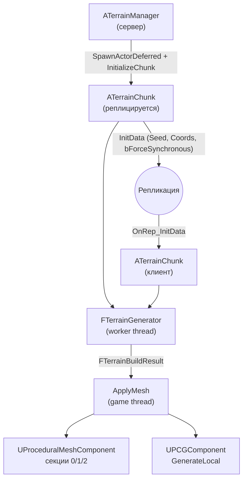
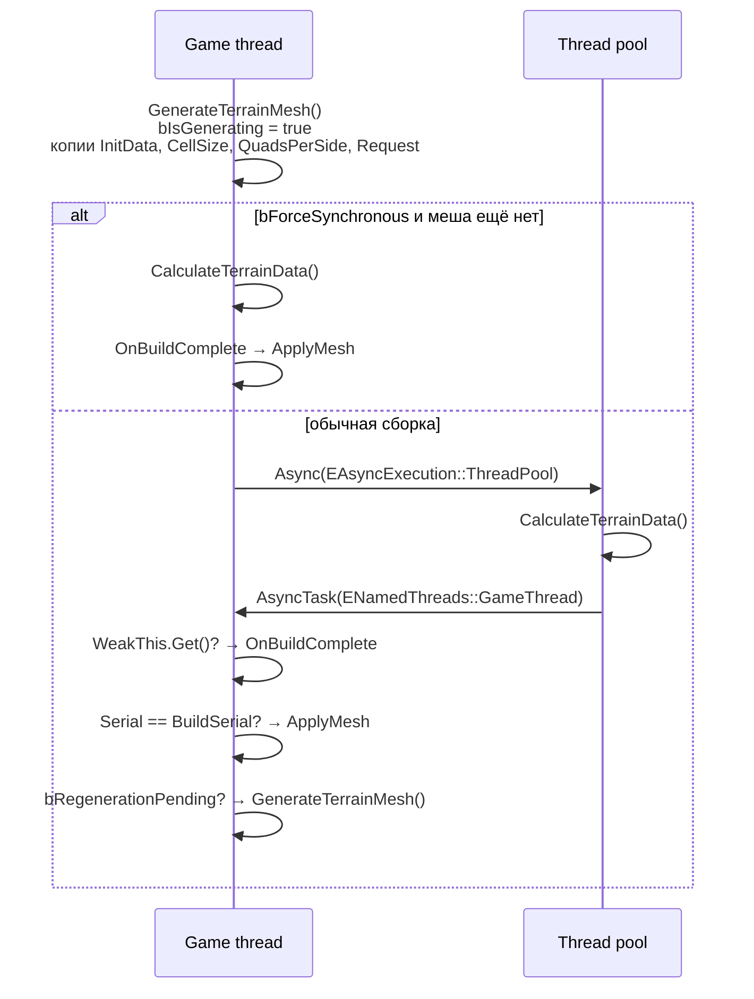

# MPSurv — технический документ

Состояние на 15.10.2026. Документ описывает код в `Source/MPSurv` и отражает его текущее состояние; проект в этом состоянии не компилировался.

## 1. Обзор

MPSurv — мультиплеерный survival-проект на Unreal Engine 5.8 (C++). Основная реализованная подсистема — бесконечный процедурный ландшафт:

- мир делится на квадратные чанки 64 × 64 м, которые спавнит сервер;
- рельеф строится детерминированно из `Seed` и координат чанка, поэтому по сети реплицируются только эти данные, а не геометрия;
- острова и океаны задаёт шум континентальности, биомы суши — сетка Вороного;
- тяжёлые вычисления геометрии выполняются в пуле потоков, на game thread только загружается готовый меш;
- каждая рендерящая машина сама выбирает LOD по своей камере, коллизией управляет сервер.

Кроме ландшафта есть базовый персонаж от третьего лица на Enhanced Input.

## 2. Стек и конфигурация

| Параметр | Значение |
|---|---|
| Движок | Unreal Engine 5.8 (`EngineAssociation: 5.8`) |
| Модуль | `MPSurv` (Runtime) |
| Зависимости модуля | Core, CoreUObject, Engine, InputCore, EnhancedInput, ProceduralMeshComponent (public); PCG (private) |
| Плагины | ProceduralMeshComponent, PCG, ModelingToolsEditorMode (только редактор) |
| Рендер | DX12 SM6, Lumen (GI и отражения), Virtual Shadow Maps, Ray Tracing, Substrate, Mesh Distance Fields |
| Карта по умолчанию | `/Engine/Maps/Templates/OpenWorld` |

Стандарты кода: Epic Coding Standard, типы UE (`TArray`, `FString`, `FVector`…) вместо `std::`. Единственное исключение — `std::atomic<bool>` для флага фоновой сборки, у которого нет прямого аналога в UPROPERTY-мире.

## 3. Структура исходников

```
Source/
├── MPSurv.Target.cs, MPSurvEditor.Target.cs
└── MPSurv/
    ├── MPSurv.Build.cs
    ├── MPSurv.h / MPSurv.cpp          — модуль
    ├── TerrainChunk.h / .cpp          — чанк ландшафта и вся математика генерации (~2050 строк)
    ├── TerrainManager.h / .cpp        — спавн, очередь и стриминг чанков
    ├── Public/BaseCharacter.h         — базовый ACharacter (шаблонная заготовка)
    ├── Public/PlayerCharacter.h       — персонаж игрока
    └── Private/BaseCharacter.cpp, PlayerCharacter.cpp
```

## 4. Архитектура



Основные типы:

| Тип | Назначение |
|---|---|
| `ATerrainManager` | Владелец сетки чанков на сервере: режимы спавна, очередь, стриминг вокруг игроков, радиус коллизии |
| `ATerrainChunk` | Реплицируемый актёр-чанк: жизненный цикл, выбор LOD, коллизия, запуск сборок, применение меша, PCG |
| `FTerrainGenerator` | Класс в `TerrainChunk.cpp` со всей математикой генерации. Хранит копии данных и не обращается к UObject, поэтому безопасен для фонового потока |
| `FTerrainGenerationSettings` | POD со всеми числами генерации; игровой поток заполняет его из ассетов и копирует в каждую сборку |
| `UWorldGenSettings` | Primary Data Asset общих параметров мира |
| `UBiomeDataAsset` | Primary Data Asset одного биома; наследник несёт только его параметры и правила травы |
| `FChunkInitData` | Реплицируемые данные чанка: `Seed`, `Coords`, `bForceSynchronous` |
| `FTerrainBuildRequest` / `FTerrainBuildResult` | Что собрать (настройки, LOD, флаги коллизии) и что получилось (буферы рельефа, воды, коллизии) |
| `FTerrainMeshBuffers` | CPU-буферы одной сетки: высоты, вершины, индексы, нормали, UV, тангенсы, цвета |
| `EBiomeType` | Строгий ID биома: Ocean = 0, Plains = 1, Forest = 2, Swamp = 3, Plateau = 4, Mountains = 5, Desert = 6, Oasis = 7 (саб-биом пустыни, только в цвете вершин) |

## 5. Сетка и система координат

| Константа | Значение | Смысл |
|---|---|---|
| `ChunkWorldSize` | 6400 см | Сторона чанка, 64 м |
| `CellSize` | 100 см | Шаг вершин на LOD 0, 1 м |
| `QuadsPerSide` | 64 | `ChunkWorldSize / CellSize`, выводится автоматически |
| `NumLODs` | 3 | LOD 0: 64×64 квада (1 м), LOD 1: 32×32 (2 м), LOD 2: 16×16 (4 м) |

- Актёр чанка ставится в `Coords * ChunkWorldSize`, геометрия строится в его локальном пространстве.
- Два `static_assert` гарантируют, что `CellSize` делит `ChunkWorldSize` нацело, а `QuadsPerSide` делится на прореживание каждого LOD.
- Все LOD сэмплируют одну и ту же поверхность полной детализации, отличается только частота выборки.

## 6. Генерация рельефа

Высота в точке считается в `FTerrainGenerator::ComputeHeight`. Этапы по порядку:

### 6.1. Сид

`GetSeedOffsets` превращает `Seed` в два смещения `SeedLow` и `SeedHigh`, взятые по модулю 256. У `FMath::PerlinNoise2D` период 256, поэтому шум получается тот же, а малые смещения сохраняют точность float в дробной части координаты.

### 6.2. Континентальность: океан или суша

`SampleContinentalness` складывает три слоя Perlin: континенты (вес 0.72), заливы и полуострова (0.20, домен повёрнут на 35°) и бухты (до 0.08, ослабевают вглубь суши). Сумма растягивается обратно к диапазону одной октавы и нормализуется в [0, 1].

- `Macro < OceanThreshold` (0.50) — океан. Дно опускается до `-OceanMaxDepth` (45 м) с пологим шельфом у берега.
- Между `OceanThreshold` и `MountainThreshold` (0.66) работает пляжный пандус: `SmoothStep(OceanLimit, MountainLimit, Macro)` умножает высоту суши, и любой биом плавно выходит из воды.
**Стартовый остров.** Сырой шум континентов (`SampleContinentNoise`) приподнимается к центру мира аддитивно:

- `Bias = SmoothStep(0, 1, Clamp(1 - Dist / StartIslandRadius, 0, 1))`: 1 в начале координат, 0 на `StartIslandRadius` (2.5 км);
- `Macro = Clamp(Noise + StartIslandLift * Bias, 0, 1)`, после чего на маску накладываются проливы;
- `StartIslandLift = Max(StartIslandStrength, MountainLimit - Noise(0, 0))` считается один раз в конструкторе генератора. Обычно это `StartIslandStrength` (0.3), но если у сида в центре глубокое море, подъём увеличивается ровно настолько, чтобы начало координат было сушей на полной высоте.

Подъём не срезает шум, а складывается с ним. Поэтому береговая линия по-прежнему идёт по изолинии шума: у острова есть заливы, мысы и холмы, а не круглый берег. Отдельной ровной зоны в центре нет: там обычный рельеф лугов.

### 6.3. Биомы суши: сетка Вороного

`QueryBiomeSites` перебирает окно 5×5 ячеек размера `BiomeCellSize` (600 м):

- точка-сайт каждой ячейки смещена хешем в пределах [0.15, 0.85] ячейки;
- сайт ячейки (0, 0) прибит к началу координат, поэтому центр мира всегда лежит глубоко внутри ячейки лугов;
- окна 5×5 достаточно: ближайший сайт не дальше 1.42 ячейки, а все сайты вне окна дальше двух ячеек.

`DetermineBiomeForCell` выбирает биом ячейки взвешенным случайным выбором (`FRandomStream` от хеша координат сайта и сида). Веса зависят от удалённости `R = clamp(Dist / BiomeFalloffRadius, 0, 1)`, где `BiomeFalloffRadius` = 1500 м:

| Биом | Вес |
|---|---|
| Plains | `clamp(1 - R, 0.1, 1)` |
| Forest | `0.6 · SmoothStep(0, 0.5, R)` |
| Swamp | `0.3 · SmoothStep(0.2, 0.7, R)` |
| Plateau | `0.35 · SmoothStep(0.3, 0.8, R)` |
| Mountains | `0.5 · SmoothStep(0.5, 1, R)` |

На стартовом острове веса Swamp, Plateau и Mountains дополнительно умножаются на `1 - Bias` (тот же `Bias`, что поднимает континентальность). Поэтому к центру остров состоит из лугов и лесов, а болота, плато и горы появляются ближе к его краям и за ними.

**Пустыни** не разыгрываются по ячейкам, их задают регионы (`IsInDesertRegion`):

- кандидаты лежат на сетке с шагом `1.5 · DesertRegionMaxSize`, по одному на ячейку сетки. Центр смещён так, что регион не выходит за свою ячейку, поэтому регионы не перекрываются;
- диаметр региона — случайный в диапазоне [`DesertRegionMinSize`, `DesertRegionMaxSize`] (600 м – 2 км);
- регион существует с шансом `DesertRegionChance · SmoothStep(0.6, 1, R) · (1 - Bias)`, где R и Bias берутся в центре региона. Пустыни лежат во внешнем мире и не появляются на стартовом острове;
- ячейка становится пустыней, если её сайт лежит в регионе. Ближайшая к центру региона ячейка входит всегда, поэтому даже регион меньше ячейки даёт пустыню хотя бы из одной ячейки.

Проверка региона идёт до броска весов, так что пустыня вытесняет любой другой биом, кроме лугов в `CenterPlainsRadius`.

Ячейки с сайтом ближе `CenterPlainsRadius` (150 м) — всегда луга. Океан и оазис не разыгрываются: океан даёт только континентальность, а оазисы ставятся внутри ячеек пустыни (см. ниже). Поэтому на одном острове может быть много биомов.

### 6.4. Смешивание биомов без швов

Основная ячейка входит с весом 1. Каждая соседняя ячейка с расстоянием `d_i` входит с весом `1 - SmoothStep(0, BlendWidth, d_i - d1)`, где `BlendWidth = 0.15 · BiomeCellSize` (90 м). Затем веса нормализуются.

Простой `Lerp` между двумя ближайшими сайтами давал разрывы в двух местах: на границе ячеек, где основной и вторичный сайты меняются местами, и там, где меняются местами второй и третий ближайшие. Смешивание всех соседей непрерывно везде.

**Болото смешивается отдельно.** Его доля `SwampShare` считается по той же формуле, но с узкой шириной `SwampBlendWidth` (30 м, не больше `BlendWidth`). Остальные биомы смешиваются как обычно, но без болота, а итог получается как `Lerp(Остальные, ComputeSwamp, SwampShare)`. Доля болота доходит до 1 примерно в 15 м от границы, так что спуск в болото получается коротким. Там, где у остальных биомов не остаётся веса, доля болота уже равна 1, поэтому смешивание непрерывно.

«Глубина» внутри ячейки `Interior = clamp(DistanceToEdge / (0.5 · BiomeCellSize), 0, 1)` определяет, насколько биом выражен. На границе все биомы сходятся к высоте `LandEdgeZ` = 2 м.

### 6.5. Высота по биомам

| Биом | Форма | Примерный диапазон высот |
|---|---|---|
| Plains | Подъём на 3 м и холмы `PlainsHillsFrequency` / `PlainsHillsAmplitude` | 1–9 м |
| Forest | Подъём на 5 м и собственные холмы: две октавы Perlin с частотой `ForestHillsFrequency` и перепадом `ForestHillsHeight`, только вверх | 2–21 м |
| Swamp | Плоская низина по всей ячейке, без холмов и без влияния континентальности: `SwampBaseHeight + Perlin(SwampPuddleNoiseFrequency) · SwampPuddleDepth`. Участки ниже 0 заполняются морской водой (лужи), выше — сухие кочки. В лужах вдали от берега строгий ID остаётся `Swamp` | от -0.6 до +1 м |
| Plateau | Меса высотой `PlateauHeight` (70 м), уступ на 0.15–0.55 глубины ячейки, каньоны с терракированными стенами, дно на 88 % глубины | до ~72 м |
| Mountains | Анизотропный гребень (ridged noise, повёрнут на 45° и растянут), отроги и скалы; масса растёт с континентальностью и глубиной ячейки | до `MountainMaxHeight` (400 м) |
| Desert | Барханы: `DesertBaseHeight + (1 - abs(Perlin))² · DesertDuneAmplitude` с частотой `DesertDuneFrequency` (~200 м). Пологие склоны, острые гребни, широкие низины. К границе ячейки барханы сглаживаются до базы | 5–30 м |

**Оазисы.** Кандидаты лежат на сетке `OasisGridSize` (300 м), по одному на ячейку. Центр и бросок шанса берутся из `FRandomStream` от хеша координат ячейки и сида, поэтому оазисы детерминированы. Кандидат остаётся, если:

- выпал шанс `OasisSpawnChance` (30 %);
- центр лежит в ячейке пустыни с запасом `BlendWidth + 2 · OasisRadius` от её границы. Тогда соседние биомы не смешиваются ни в одну точку оазиса;
- барханы в центре ниже `OasisMaxDuneHeight` (10 м) над базой: оазисы только в низинах.

Профиль по расстоянию `d` от центра (`ComputeOasisZ`):

- `d < OasisWaterRadius` (15 м): чаша до -1.5 м, её заполняет морская вода. Кромка воды ровно на `OasisWaterRadius`;
- первая половина полосы берега: склон от воды до `DesertBaseHeight`, самый крутой у воды, чтобы береговая линия была чистой;
- вторая половина до `OasisRadius` (50 м): барханы плавно (`SmoothStep`) выравниваются до `DesertBaseHeight`.

Если два оазиса перекрываются, берётся ближайший; профиль зависит только от расстояния, поэтому шва нет. Детальный шум к центру оазиса затухает. Вся площадь в радиусе `OasisRadius`, включая воду, получает строгий ID `Oasis` (7).

### 6.6. Реки: морские проливы

Реки сделаны по образцу Valheim: это не потоки с истоками, а длинные извилистые морские проливы на уровне моря (Z = 0). Они рассекают сушу от океана до океана и делят её на острова. Ручьёв и притоков нет.

- **Линия пролива** — нулевая изолиния Perlin с частотой `RiverFrequency` (по умолчанию около одного пролива на километр) и двухслойным domain warp: крупные изгибы (~800 м, смещение до 160 м) и меандры (~250 м, до 40 м).
- **Ширина в метрах.** Расстояние до середины пролива считается как `|n| / |∇n|`, где градиент берётся конечными разностями. Поэтому ширина на местности одинакова там, где шум крутой, и там, где пологий. Ширина воды `RiverWidth` (40 м) колеблется ×0.7–1.3 с длиной волны ~500 м.
- **Пролив — часть моря.** `ComputeStraitMacroCap` опускает саму маску континентальности (`SampleContinentalness`) до «потолка»:
  - в середине — ниже порога океана, так что дно на `-RiverDepth` (10 м), с плоским дном на 40 % полуширины;
  - у кромки воды — ровно `OceanThreshold`;
  - дальше потолок растёт линейно и достигает `MountainThreshold` через `RiverShoreWidth` (60 м).

  Потолок только понижает маску. Отсюда:
  - любой биом спускается к проливу тем же пляжным пандусом, что и к морю;
  - горы у пролива ниже, потому что их масса зависит от континентальности;
  - озёра не ставятся у пролива;
  - ID биома в проливе — `Ocean`;
  - с открытым морем пролив сливается без шва (`Min`).
- **Центр мира.** В радиусе `StraitFreeRadius` (300 м) проливов нет. За следующие 200 м действие потолка плавно нарастает (`Lerp(Macro, Min(Macro, Cap), SmoothStep(...))`). Пролив, подошедший к центру, мелеет и заканчивается заливом. У краёв стартового острова проливы и заливы режут его как обычно.
- **Пустыни.** Проливы не пересекают пустыни: сила потолка умножается на `1 - доля пустыни`. Доля считается по тем же весам, что и смешивание высот (`ComputeBiomeShare`). Пролив затухает в полосе смешивания вокруг ячейки пустыни и заканчивается заливом у её края. Запрос Вороного делается только для точек рядом с проливом.
- **Замкнутые линии.** Замкнутая изолиния даёт кольцевой пролив вокруг острова. Для проливов это нормально.

### 6.7. Горные озёра

- **Кандидаты:** по одному на ячейку 400 × 400 м с вероятностью 35 %.
- **Морфология:** тектонический разлом (эллипс 1:2–2.6 вдоль хребта) или ледниковый кар (подкова с крутой задней стенкой). Берег неровный за счёт warp.
- **Валидация (`ValidateLake`):** центр на суше и глубоко в горной ячейке (Interior ≥ 0.3); по кольцу из 8 точек за берегом поверхность остаётся горной и не ниже 5 м над прибрежной сушей. Иначе озеро перелилось бы через низкий край.
- **Рельеф:** чаша под водой, проходимое дно долины на несколько метров выше воды и плавный переход обратно в горы. Всё смешивается весом гор, поэтому долина, выходящая за горную ячейку, сопрягается с соседом без шва.
- `CacheChunkLakes` один раз за сборку собирает озёра, достающие до чанка с учётом бордюра высот. Охват ~400 м — `LakeMaxReach`.

### 6.8. Детальный шум и строгий ID биома

- Детальный шум: ±2 м на лугах и до ±8 м на вершинах. Гасится у озёр и в пределах 2 м от уровня моря, чтобы береговая линия оставалась ровным контуром, а не «лесенкой» по сетке.
- `GetTerrainDeltaHeight` — заготовка под будущие правки ландшафта в рантайме, сейчас возвращает 0.
- **Строгий ID:** `Ocean`, если точка в море или это затопленный берег (устья, кромки болот ниже нуля); `Oasis`, если точка в радиусе оазиса; иначе биом основной ячейки. В цвет вершины пишется не он один, а два биома с наибольшим весом: R — меньший ID, G — больший, B — вес G (0..255). Более тяжёлый биом — G при B ≥ 128, иначе R. Море и оазис остаются более тяжёлым биомом, чтобы их ID не выпал из пары.

## 7. Меш

### 7.1. Секции `UProceduralMeshComponent`

| Индекс | Содержимое | Коллизия |
|---|---|---|
| 0 | Рельеф текущего LOD с юбками, `TerrainMaterial` | Только если нужна коллизия и LOD = 0 |
| 1 | Вода (море и озёра), `WaterMaterial` | Нет |
| 2 | Скрытая сетка LOD 0 без юбок | Да. Создаётся, когда на рендерящем authority (listen-сервер, standalone) нужна коллизия, а визуальный LOD грубее 0 |

На dedicated-сервере есть только секция 0 на LOD 0 без юбок и воды, и только пока коллизия включена. Без коллизии сервер не строит геометрию вовсе. Компонент использует `bUseAsyncCooking` и `bUseComplexAsSimpleCollision`.

### 7.2. Построение сетки (`BuildTerrainBuffers`)

1. Высоты сэмплируются с бордюром в одну клетку: `(QuadCount + 3)²` значений. Центральные разности на краю чанка берут соседнюю поверхность, поэтому нормали на стыке совпадают.
2. Триангуляция адаптивная (`BuildAdaptiveTriangles`): каждый квад режется по диагонали с более близкими высотами концов. Хребты и русла под углом к сетке не превращаются в зубцы.
3. Нормаль = `(hL - hR, hD - hU, 2·Step / NormalStrength)`, тангенс по +X, UV в [0, 1] по чанку.
4. Цвет вершины: `R` — строгий `EBiomeType`.
5. Юбки (`AppendSkirts`): край опущен на `SkirtDepth` (10 м), нормали и цвет копируются с края. Закрывает щели между соседями разного LOD.

### 7.3. Вода (`BuildWaterBuffers`)

- Квад получает воду, если над ним озеро с валидным дном (не над обрывом) или если хоть один его угол не выше `0 + 1.5 м` (море). Кромка уходит под берег, и шейдер может растушевать линию воды.
- У каждого уровня воды своя карта вершин, поэтому море и озеро не сшиваются через разные высоты.
- UV в мировых метрах, поэтому текстуры волн тайлятся бесшовно между чанками.
- Цвет вершины RGB — маска затухания волн: 0 у берега, 255 на глубине от 30 см.

### 7.4. Объём на один чанк

| LOD | Вершин (без юбок) | Треугольников | Сэмплов высоты |
|---|---|---|---|
| 0 | 65² = 4225 (+256 юбки) | 8192 (+512) | 67² = 4489 |
| 1 | 33² = 1089 (+128) | 2048 (+256) | 35² = 1225 |
| 2 | 17² = 289 (+64) | 512 (+128) | 19² = 361 |

## 8. Многопоточность



- **Статическая точка входа.** `ATerrainChunk::CalculateTerrainData(InitData, InCellSize, InQuadsPerSide, Request)` не использует `this`. Она создаёт `FTerrainGenerator` из копий и возвращает `FTerrainBuildResult` по значению.
- **Потокобезопасность.** В фоне работают только `FMath`, `FRandomStream`, хеши и скопированные данные. К UObject нет ни одного обращения. Указатель на актёр передаётся как `TWeakObjectPtr` и разыменовывается только на game thread.
- **Одна сборка за раз.** `std::atomic<bool> bIsGenerating`. Запрос, пришедший во время сборки (смена LOD, включение коллизии), не теряется: ставится `bRegenerationPending`, и после применения результата сборка повторяется с актуальным состоянием.
- **Устаревшие результаты.** `BuildSerial` увеличивается при каждой смене `InitData` (`InitializeChunk`, `OnRep_InitData`). Результат сборки для старых данных отбрасывается.
- **Синхронный режим.** Если `FChunkInitData::bForceSynchronous` и меша ещё нет, первая сборка идёт прямо в вызывающем потоке. Последующие пересборки всегда асинхронны. Флаг реплицируется, поэтому клиенты тоже строят стартовые чанки синхронно.
- **Уничтожение во время сборки.** Воркер не держит ссылок на UObject. Если актёр уничтожен, `WeakThis.Get()` вернёт `nullptr`, и результат будет выброшен.
- **Озёра.** Кэш озёр живёт в генераторе и пересчитывается каждой сборкой, а не хранится в актёре.

Кто получает синхронную сборку:

| Где | Условие |
|---|---|
| `SpawnChunksInRadius` (DynamicStreaming) | Все чанки предспавна вокруг `PlayerStart` и уже существующих пешек при старте |
| `Tick` (StaticDebugGrid) | Только самый первый чанк сессии (`ActiveChunks.IsEmpty()`), то есть центральный |
| Остальные | Асинхронно, включая срочные спавны стриминга в `PreSpawnRadius` |

## 9. Сеть и коллизия

- `ATerrainChunk` и `ATerrainManager` реплицируются, движение актёров не реплицируется.
- Реплицируется только `InitData` (`ReplicatedUsing = OnRep_InitData`). Каждый клиент строит ту же поверхность сам.
- `NetCullDistanceSquared = (16 · ChunkWorldSize)²`, то есть чанки видны клиенту в радиусе ~1 км, чтобы он мог показывать дальние LOD.
- **LOD** выбирается локально на каждой рендерящей машине. Таймер `LODUpdateInterval` (0.5 с) со случайной первой задержкой. Расстояние считается по горизонтали до ближайшей точки квадрата чанка: чанк под камерой всегда на расстоянии 0, и высокая гора не может перевести его на грубый LOD. Пороги: LOD 1 дальше 128 м, LOD 2 дальше 320 м, гистерезис 10 м на переход к более грубому LOD.
- **Коллизия на authority** — флаг `bServerCollisionEnabled`, его выставляет менеджер (`SetCollisionEnabled`) для чанков в `CollisionRadiusInChunks` (2 чанка) от любого игрока.
- **Коллизия на клиенте** — только на LOD 0. Это область вокруг локального игрока, и для предсказания движения пол клиента совпадает с серверным.
- На dedicated-сервере `ComputeTargetLOD` всегда возвращает 0, LOD-таймер не запускается.

## 10. `ATerrainManager`

Работает только на authority. Режим задаёт `SpawnMode`.

### 10.1. `StaticDebugGrid`

Нужен только для осмотра ландшафта в режиме Simulate в редакторе, в геймплее не используется.

- `SpawnInitialGrid` кладёт в `GenerationQueue` квадрат `[-GridRadius, GridRadius]²`. При `GridRadius` = 15 это 31 × 31 = 961 чанк, около 2 × 2 км. Очередь сортируется по убыванию расстояния, а `Pop` берёт с конца, так что сетка растёт от центра.
- `Tick` включён только пока очередь не пуста и спавнит `ChunksPerFrame` чанков за кадр. Это ограничивает стоимость спавна за кадр и число одновременных фоновых сборок с их временными буферами.
- Чанки спавнятся без коллизии. Первый (центральный) строится синхронно.

### 10.2. `DynamicStreaming`

- **Старт (`StartDynamicStreaming`):** синхронный предспавн радиусом `PreSpawnRadius` вокруг каждого `PlayerStart` и уже существующих пешек (или вокруг начала координат, если их нет), затем запуск таймера `StreamingUpdateInterval` (0.25 с).
- **`UpdateStreaming`:**
  1. Собирает позиции пешек. Без пешек ничего не делает и сохраняет чанки до респавна.
  2. Выгружает чанки дальше `StreamingRadius + DespawnMargin` от всех игроков (гистерезис против мерцания), а также записи, уничтоженные извне.
  3. Выставляет коллизию всем активным чанкам по `CollisionRadiusInChunks`.
  4. Собирает недостающие чанки в кругах загрузки и сортирует их по расстоянию до ближайшего игрока.
  5. Спавнит до `MaxChunksPerUpdate` за обновление. Чанки в `PreSpawnRadius` от игрока спавнятся вне бюджета.
- Расстояние до чанка везде считается до ближайшей точки его квадрата, поэтому радиус выбирает все чанки, которых касается круг.
- **Отладка:** `bLogStreaming` пишет лог изменений, `bDrawStreamingDebug` рисует круги загрузки (зелёный) и выгрузки (красный).

`SpawnChunk` использует `SpawnActorDeferred`. Он выставляет коллизию до первой сборки (чтобы dedicated-сервер не строил геометрию для чанка без коллизии), затем вызывает `InitializeChunk` и `FinishSpawning` и регистрирует чанк в `ActiveChunks`.

## 11. PCG

- `UPCGComponent` создаётся в конструкторе чанка неактивным, с `GenerationTrigger = GenerateOnDemand`.
- `GeneratePCG()` вызывается из `ApplyMesh` после появления секций. Он запускает `GenerateLocal(true)` один раз на `InitData`; пересборки LOD PCG не перезапускают.
- Генерация локальная, не сетевая: все машины строят одинаковый рельеф и сами получают одинаковый детерминированный результат.
- Граф PCG в коде не назначается. Его нужно задать в Blueprint-наследнике `ATerrainChunk` и указать этот класс в `ATerrainManager::ChunkClass`.
- Источник биома для графа — более тяжёлый из пары в цвете вершины: канал G, если B ≥ 128, иначе канал R. Сами ID в R и G на границе двух биомов совпадают у соседних вершин, интерполируется только вес в B.

## 12. Персонаж

- `ABaseCharacter` — шаблонная заготовка от `ACharacter`, логики нет.
- `APlayerCharacter` — камера от третьего лица на `USpringArmComponent` (300 см, вращение от контроллера). Тело поворачивается по направлению движения (`bOrientRotationToMovement`, 500°/с).
  - Ввод через Enhanced Input: `IA_Look` (yaw и pitch) и `IA_Walk` (движение относительно yaw камеры). `DefaultMappingContext` добавляется в `NotifyControllerChanged`.
  - Ассеты ввода задаются в Blueprint-наследнике.

## 13. Параметры

### 13.1. Настройки генерации

Общие параметры мира задаются ассетом `UWorldGenSettings`, форма каждого биома — своим наследником `UBiomeDataAsset` (океан, луга, лес, болото, плато, горы, пустыня, оазис). `ATerrainManager` хранит мягкие ссылки, на игровом потоке синхронно загружает ассеты и копирует числа в `FTerrainGenerationSettings`, а правила травы — в массив без указателей на меши. Воркер получает только эту копию. Незаданный ассет оставляет значения по умолчанию в коде. Размер пустынных регионов и шаг сетки оазисов — параметры раскладки мира, они лежат на `UWorldGenSettings`.

**Общие** (`UWorldGenSettings`)

| Параметр | По умолчанию | Категория | Назначение |
|---|---|---|---|
| `NormalStrength` | 1.0 | Mesh | Усиление уклона в нормалях |
| `SkirtDepth` | 1000 см | Mesh | Глубина юбок LOD |
| `MacroFrequency` | 0.000012 | Continentalness | Частота маски континентальности |
| `OceanThreshold` | 0.50 | Continentalness | Порог океана |
| `MountainThreshold` | 0.66 | Continentalness | Конец пляжного пандуса |
| `StartIslandRadius` | 250000 см | Start Island | Радиус стартового острова |
| `StartIslandStrength` | 0.3 | Start Island | Подъём континентальности в центре |
| `StraitFreeRadius` | 30000 см | Start Island | Радиус без проливов (+200 м затухания) |
| `BiomeCellSize` | 60000 см | Biomes | Размер ячейки Вороного |
| `CenterPlainsRadius` | 15000 см | Biomes | Луга в центре |
| `BiomeFalloffRadius` | 150000 см | Biomes | Удалённость полного разнообразия биомов |
| `DesertRegionMinSize` / `DesertRegionMaxSize` / `DesertRegionChance` | 60000 / 200000 см / 0.6 | Desert Regions | Размер и шанс пустынного региона |
| `OasisGridSize` | 30000 см | Oasis | Шаг сетки кандидатов оазиса |
| `RiverFrequency` | 0.000006 | Rivers | Частота морских проливов |
| `RiverWidth` / `RiverShoreWidth` / `RiverDepth` | 4000 / 6000 / 1000 см | Rivers | Ширина воды, берега, глубина |

**По биомам** (свой `UBiomeDataAsset`; частота и амплитуда холмов и детали у каждого свои. `DesertRegion*` и `OasisGridSize` — на `UWorldGenSettings`)

| Биом | Параметры | По умолчанию |
|---|---|---|
| Ocean | `OceanMaxDepth`, `OceanHillsFrequency` / `OceanHillsAmplitude`, `OceanDetailFrequency` / `OceanDetailAmplitude` | 4500; 0.00009 / 800; 0.00025 / 20 |
| Plains | `PlainsHillsFrequency` / `PlainsHillsAmplitude`, `PlainsDetailFrequency` / `PlainsDetailAmplitude` | 0.00009 / 400; 0.00025 / 200 |
| Forest | `ForestHillsFrequency` / `ForestHillsHeight`, `ForestDetailFrequency` / `ForestDetailAmplitude` | 0.0002 / 1400; 0.00025 / 200 |
| Swamp | `SwampBaseHeight`, `SwampPuddleNoiseFrequency` / `SwampPuddleDepth`, `SwampBlendWidth` | 20; 0.001 / 80; 3000 (детали нет) |
| Plateau | `PlateauHeight`, `CanyonFrequency` / `CanyonWidth` / `CanyonFloorWidth`, `PlateauHillsFrequency` / `PlateauHillsAmplitude`, `PlateauDetailFrequency` / `PlateauDetailAmplitude` | 7000; 0.000032 / 0.22 / 0.06; 0.00009 / 400; 0.00025 / 200 |
| Mountains | `MountainMaxHeight`, `RidgeFrequency`, `MountainsBaseHillsFrequency` / `MountainsBaseHillsAmplitude`, `MountainsDetailFrequency` / `MountainsDetailAmplitude` | 40000; 0.000016; 0.00009 / 400; 0.00025 / 800 |
| Desert | `DesertDuneFrequency` / `DesertDuneAmplitude`, `DesertBaseHeight`, `DesertDetailFrequency` / `DesertDetailAmplitude` | 0.00005 / 2500; 500; 0.00025 / 50 |
| Oasis | `OasisSpawnChance`, `OasisRadius` / `OasisWaterRadius`, `OasisMaxDuneHeight` | 0.3; 5000 / 1500; 1000 (детали нет) |

### 13.2. Чанк (LOD)

| Параметр | По умолчанию |
|---|---|
| `LOD1Distance` | 12800 см |
| `LOD2Distance` | 32000 см |
| `LODHysteresis` | 1000 см |
| `LODUpdateInterval` | 0.5 с |
| `TerrainMaterial`, `WaterMaterial` | Не заданы |

### 13.3. `ATerrainManager`

| Параметр | По умолчанию |
|---|---|
| `ChunkClass` | `ATerrainChunk` |
| `WorldSeed` | 1337 (0 = чанки без геометрии) |
| `SpawnMode` | `StaticDebugGrid` |
| `ChunksPerFrame` | 1 |
| `GridRadius` | 15 |
| `StreamingRadius` / `DespawnMargin` | 8 / 2 чанка |
| `StreamingUpdateInterval` | 0.25 с |
| `MaxChunksPerUpdate` | 4 |
| `CollisionRadiusInChunks` | 2 |
| `PreSpawnRadius` | 2 |

## 14. Детерминизм

- Вся случайность берётся из `Seed` и координат: `FRandomStream` от `HashCombine(GetTypeHash(...), Seed)` для ячеек биомов и озёр и `FMath::PerlinNoise2D` со смещениями сида.
- Порядок обхода фиксирован. Озёра перебираются в глобальном порядке (CellY, CellX), поэтому перекрывающиеся долины складываются одинаково при любом источнике запроса.
- Высоты считаются в мировых координатах, а бордюр берёт поверхность соседа, поэтому стыки чанков совпадают и по высоте, и по нормалям, и по ID биома.

## 15. Известные ограничения и риски

- **Не скомпилировано.** Последние изменения (асинхронная генерация, перенос параметров в `FTerrainGenerationSettings`) проверены только линтером.
- **Детерминизм float между платформами.** Сервер и клиенты считают высоты независимо. На разных компиляторах или CPU возможны расхождения в младших битах float. Для коллизии это доли миллиметра, но точное совпадение не гарантировано.
- **Асинхронная коллизия.** Обычные чанки стриминга, включая срочные в `PreSpawnRadius`, получают коллизию через несколько кадров после спавна (фоновая сборка плюс async cooking). При очень быстром перемещении игрок может обогнать генерацию.
- **Пересчёт озёр.** Каждая сборка, включая смену LOD, заново ищет и валидирует озёра. Это дешевле самой сетки, но не бесплатно.
- **Настройки биомов в Primary Data Asset.** Общая форма мира — `UWorldGenSettings`, каждый биом — свой наследник `UBiomeDataAsset`. Менеджер загружает их на игровом потоке. Пока ассеты не назначены, генерация берёт значения по умолчанию из `FTerrainGenerationSettings`. Меши травы задаются на ассете биома, не на чанке.
- **Устаревшие комментарии в `TerrainManager.h`.** Описания `StaticDebugGrid` и `ChunksPerFrame` всё ещё говорят о синхронной сборке каждого чанка.
- **`GetTerrainDeltaHeight`** — заглушка, правки ландшафта в рантайме не реализованы.
- **`ABaseCharacter`** — пустая заготовка с включённым Tick.

## 16. Настройка сцены

1. Поставить на уровень `ATerrainManager` (или его Blueprint) и задать ненулевой `WorldSeed`.
2. Для осмотра ландшафта: `SpawnMode = StaticDebugGrid`, запуск через Simulate. Коллизии нет, поэтому персонаж провалится, и это ожидаемо.
3. Для игры: `SpawnMode = DynamicStreaming`, на уровне должны быть `PlayerStart`.
4. Создать Blueprint-наследник `ATerrainChunk`: назначить `TerrainMaterial`, `WaterMaterial` и граф PCG, затем указать его в `ChunkClass`. Материал рельефа читает два ID биома из R и G и вес G из B. Материал воды читает маску волн из RGB.
5. Создать Blueprint-наследник `APlayerCharacter` с `DefaultMappingContext`, `IA_Look` и `IA_Walk`.
